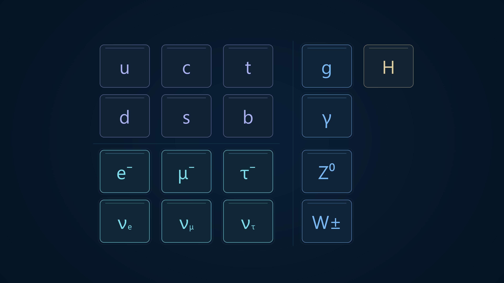

# IceCube Neutrino Observatory

Ten finished science animations for a Turkish-language video about IceCube and neutrinos. The visuals use a consistent navy/ice-blue palette and mostly universal symbols, so they can be reused with dubbing or subtitles in other languages.

The latest revised versions are included. All master videos are native **3840 × 2160, 30 fps, silent H.264 MP4**. Timing follows an estimated narration pace; no recorded voice track was supplied. Turkish narration is provided separately in SRT files and timing metadata.

## Animations

| # | Animation | Duration | Videos | Renderer |
|---|---|---:|---|---|
| 01 | IceCube detector array | 32 s | [4K](exports/icecube_array_v2_4k/01_icecube_dizilim_yazisiz_4k.mp4) · [1080p](exports/icecube_array_v2/01_icecube_dizilim_yazisiz.mp4) | [Python](animation/icecube_samples/export_array_4k.py) |
| 02 | PMT electron multiplication | 24 s | [4K](exports/pmt_bunches_v2/02_pmt_elektron_demetleri_4k.mp4) · [1080p](exports/pmt_bunches_v2/02_pmt_elektron_demetleri_onizleme_1080p.mp4) | [Python](animation/icecube_samples/render_pmt_v2.py) |
| 03 | Solar photons and neutrinos | 34 s | [4K](exports/solar_neutrinos_v2/03_gunes_notrinolari_4k.mp4) · [1080p](exports/solar_neutrinos_v2/03_gunes_notrinolari_onizleme_1080p.mp4) | [Python](animation/icecube_samples/render_solar_neutrinos.py) |
| 04 | Electrons, muons and metal plates | 82 s | [4K](exports/leptons_plates_v1/04_notrino_elektron_muon_plakalar_4k.mp4) · [1080p](exports/leptons_plates_v1/04_notrino_elektron_muon_plakalar_onizleme_1080p.mp4) | [Python](animation/icecube_samples/render_leptons_plates.py) |
| 05 | Light speed in vacuum and water | 40 s | [4K](exports/light_speed_v1/05_isigin_hizi_vakum_su_4k.mp4) · [1080p](exports/light_speed_v1/05_isigin_hizi_vakum_su_onizleme_1080p.mp4) | [Python](animation/icecube_samples/render_light_speed.py) |
| 06 | Sonic boom and Cherenkov radiation | 32 s | [4K](exports/cherenkov_v2/06_sonik_patlama_cherenkov_4k.mp4) · [1080p](exports/cherenkov_v2/06_sonik_patlama_cherenkov_onizleme_1080p.mp4) | [Python](animation/icecube_samples/render_cherenkov_v2.py) |
| 07 | Direction, timing and ice calibration | 132 s | [4K](exports/direction_calibration_v3/07_yon_zamanlama_buz_kalibrasyon_4k.mp4) · [1080p](exports/direction_calibration_v3/07_yon_zamanlama_buz_kalibrasyon_onizleme_1080p.mp4) | [Python](animation/icecube_samples/render_direction_calibration_v3.py) |
| 08 | IceCube history | 70 s | [4K](exports/icecube_history_v1/08_icecube_tarihce_4k.mp4) · [1080p](exports/icecube_history_v1/08_icecube_tarihce_onizleme_1080p.mp4) | [Python](animation/icecube_samples/render_history.py) |
| 09 | Understanding the world with light | 40 s | [4K](exports/light_applications_v1/09_isikla_anlamak_4k.mp4) · [1080p](exports/light_applications_v1/09_isikla_anlamak_onizleme_1080p.mp4) | [Python](animation/icecube_samples/render_light_applications.py) |
| 10 | Standard Model and cosmic neutrinos | 38 s | [4K](exports/particle_table_v2/10_temel_parcaciklar_notrinolar_4k.mp4) · [1080p](exports/particle_table_v2/10_temel_parcaciklar_notrinolar_onizleme_1080p.mp4) | [Python](animation/icecube_samples/render_particle_table_v2.py) |



## Reproduce

Use Python 3.11+ and install FFmpeg separately. Run these commands from this folder:

```sh
python -m pip install -r requirements.txt
python animation/icecube_samples/render_particle_table_v2.py --scale 2
```

All normal renderers in the table accept `--scale 2` for native 4K and `--scale 1` for 1080p. Add `--preview` to generate only still previews and timing files. A 4K run also creates a 1080p viewing copy. Render commands overwrite the corresponding files inside `exports/`.

The first animation has a separate native-4K entry point:

```sh
python animation/icecube_samples/export_array_4k.py
python animation/icecube_samples/render_array_v2.py
```

The second command reproduces its original 1080p version and narration metadata. `render.py` is retained as a shared helper dependency, not as the entry point for the final animations. Keep the source files together: some renderers reuse geometry and drawing helpers from other scenes.

FFmpeg is resolved from `FFMPEG_BINARY`, then PATH, then the original Windows installation location. The original videos use Segoe UI on Windows. The source also checks common DejaVu Sans, Liberation Sans and Arial locations. Set `ANIMATION_FONT` and `ANIMATION_FONT_BOLD` to custom TrueType font paths if needed. A different font can slightly change symbol placement. No font files are redistributed.

Source geometry and timing are preserved; the packaging changes only make executable/font paths configurable and remove a machine-specific document path. The published MP4s are byte-for-byte copies of the final local exports. Their SHA-256 hashes are recorded in `manifest.json`.

## Contents and scientific notes

- `animation/icecube_samples/`: editable Python renderers and shared helpers.
- `exports/`: final videos, poster frames, Turkish SRT narration, timing JSON and scene-specific notes.
- `manifest.json`: titles, file paths, durations and video checksums.
- `requirements.txt`: versions of NumPy and Pillow used for production.

The visualizations are schematic, not raw IceCube measurements or detector-response simulations. Timing values, object sizes and travel times may be exaggerated for readability. Consult each export folder's `KURGU_NOTLARI.md` or `NOTLAR.md` for scientific details and source links.

The final revisions include the corrected rearward Cherenkov cone, distance-dependent DOM hits, a single-muon timing event with six DOMs on two strings, and foreground neutrino cards in the Standard Model transition.
